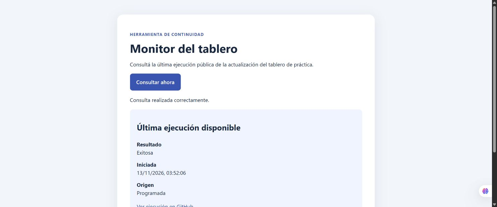
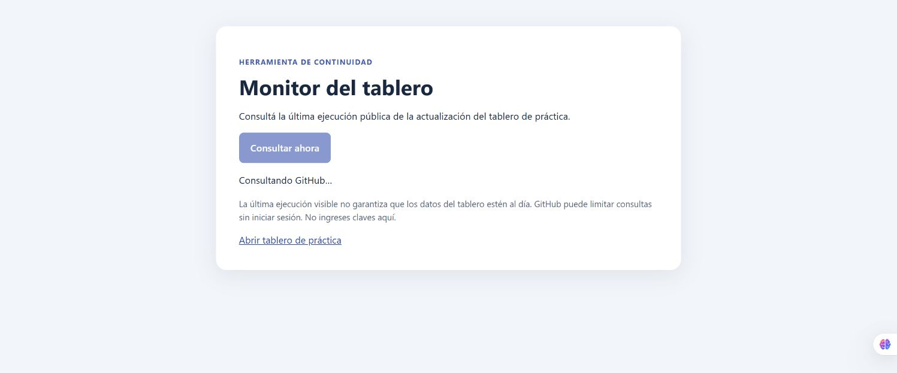
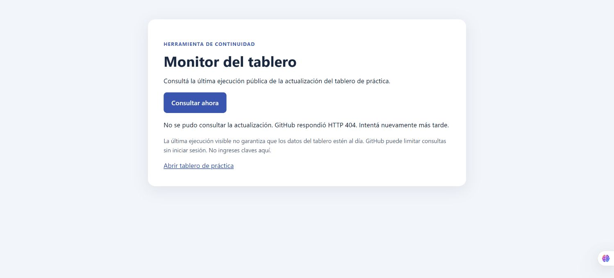
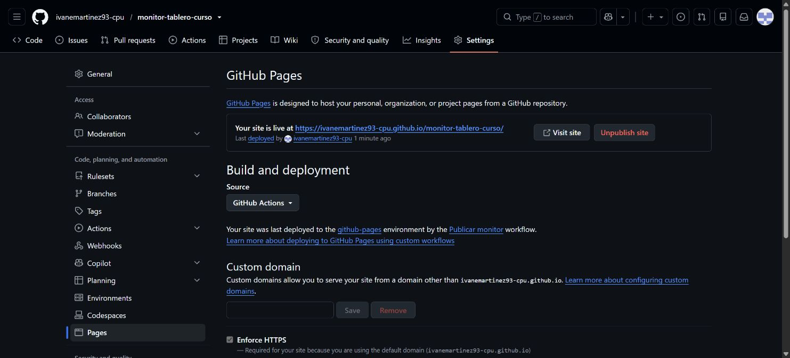

# Monitor del tablero de práctica

Aplicación de curso para consultar la última ejecución pública del flujo de actualización del tablero de continuidad. No accede a ClickUp, no requiere credenciales y no modifica tareas. Una ejecución exitosa no demuestra por sí sola que los datos publicados estén actualizados.

Monitor publicado: https://ivanemartinez93-cpu.github.io/monitor-tablero-curso/

## Ejecutar

Requiere Node.js 22.12 o superior. Ejecutar `npm install` y `npm run dev`; abrir la dirección que muestra Vite. Para generar la versión compilada: `npm run build`; para revisarla: `npm run preview`.

La URL pública de la API se configura con `VITE_API_URL` en un archivo `.env` opcional; se incluye `.env.example` vacío. Si no se define, se usa `https://api.github.com`. Los valores VITE se incluyen en el navegador: nunca colocar secretos allí. GitHub limita peticiones anónimas y puede devolver errores o información no disponible.

## Diseño y evolución

`service.js` consulta y valida la respuesta, `ui.js` gestiona la interfaz y `main.js` coordina. Se muestran carga, resultado y error. El repositorio consultado y el flujo son los del tablero de práctica autorizado, no los proyectos reales.

Tecnologías: HTML, CSS, JavaScript ES modules y Vite. Fuente: API pública de GitHub Actions, sin autenticación.

## Evidencias

Consulta exitosa en la aplicación publicada: resultado y origen de la última ejecución.

Estado de carga capturado en producción tras pulsar «Consultar ahora».

Prueba local con una ruta de API inexistente: HTTP 404 y mensaje visible.

Panel de GitHub Pages con publicación mediante Actions. La URL de API es opcional y se usa el valor público predeterminado; no hay secretos ni variables obligatorias que configurar en producción.

## Estado y evidencia

Curso: Del prototipo a producción, Coderhouse. El proyecto es una implementación nueva inspirada en una necesidad de continuidad; no constituye una refactorización del tablero existente. Se probó la compilación, una consulta exitosa y un error HTTP 404 en local, y una consulta exitosa en la página publicada. No se probó el estado vacío.

